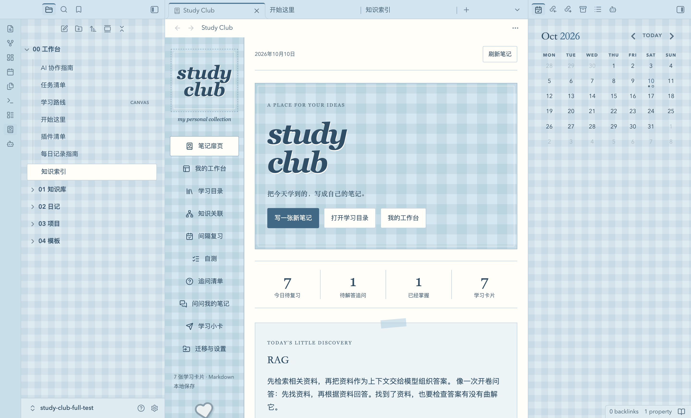
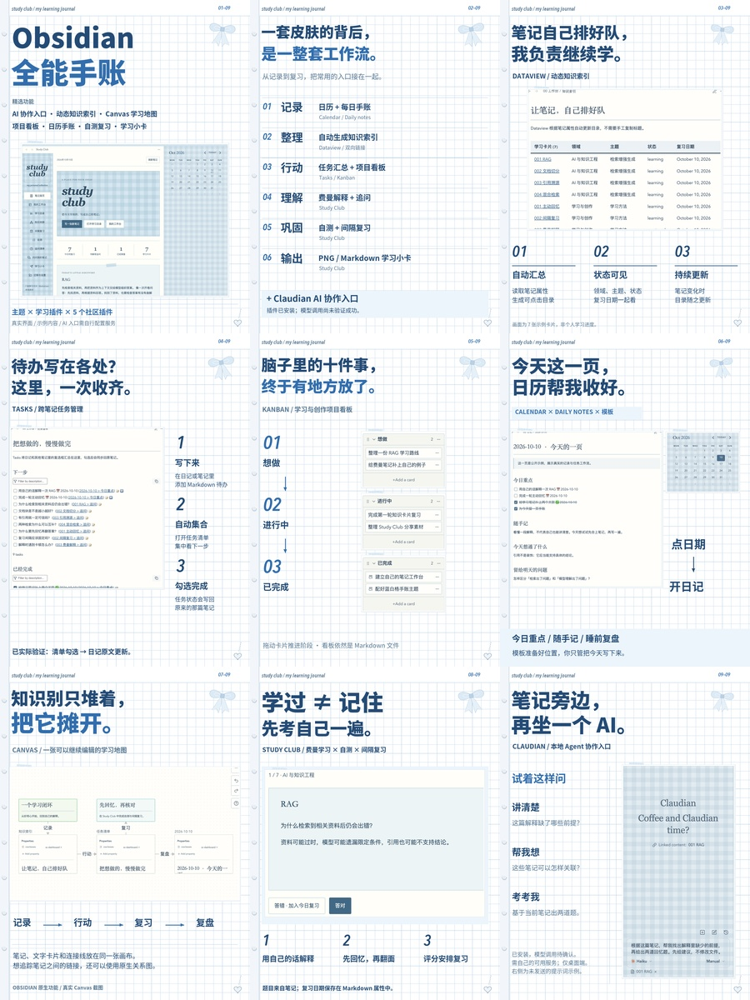

# Study Club for Obsidian

**把记录、整理、自测和复习，放进一本蓝白格学习手账。**

Study Club 是一套 Obsidian 主题和学习插件。笔记使用 Markdown 文件保存，学习状态和复习日期写入笔记属性；停用插件后仍可阅读和编辑。

**目录规则：**`01 知识库` 是学习卡片和追问的唯一数据源；Study Club 只是实时读取这些 Markdown 的学习界面，不再创建同名笔记文件夹。



## 功能

| 模块 | 可以做什么 |
| --- | --- |
| 费曼笔记 | 记录定义、自己的解释、类比、原理、应用、来源和追问 |
| 学习目录 | 搜索笔记，按学习状态筛选和管理 |
| 知识关联 | 查看 Obsidian 双向链接，打开原生关系图 |
| 自测 | 从笔记读取问题与答案，答错后加入今日复习 |
| 间隔复习 | 四档评分，更新复习日期并保存评分记录 |
| 追问清单 | 将问题保存为独立 Markdown，记录回答与解决状态 |
| 笔记问答 | 本地关键词检索和关联扩展，查看原文；可选 AI 整理 |
| 学习小卡 | 导出 PNG 图片或独立 Markdown 摘录 |
| JSON 迁移 | 将 Study Club 网页版全量备份转换成文件夹、Markdown 和双向链接 |
| 工作台 | 连接知识索引、待办、日记、看板和 Canvas 学习路线 |

主题包含浅色和深色配色。示例仓库提供 **7 张示例卡片**、日记、项目看板与 Canvas；它们不是作者的私人学习记录。

## 安装

### 下载即用

仓库的 [`downloads/`](downloads/) 提供当前版本的安装文件：

- `study-club-plugin.zip`：解压，将 `study-club` 文件夹放进你的仓库 `.obsidian/plugins/`。
- `study-club-theme.zip`：解压，将 `Study Club` 文件夹放进 `.obsidian/themes/`。
- `study-club-starter.zip`：解压后，在 Obsidian 中选择“打开本地仓库”，打开 `Study Club Starter` 文件夹。

在 **设置 → 第三方插件**启用 Study Club；在 **设置 → 外观**选择 Study Club 主题。点击侧边栏的书本爱心图标即可打开。

macOS 可用 `Command + Shift + .` 显示 `.obsidian` 隐藏目录。

插件要求 Obsidian **1.5.0+**。下面的完整社区插件组合建议使用 **1.13.0+ 桌面版**。

### 从 0.1.0 升级

先备份仓库，再替换 `.obsidian/plugins/study-club/` 中的插件文件。更新后运行命令：

`Study Club: 迁移旧版 Study Club 笔记到 01 知识库`

迁移会移动整个旧文件夹，并由 Obsidian 更新内部链接，不会覆盖已有文件。若 `01 知识库` 已存在，旧内容会进入带日期的迁移子目录。

### 可选社区插件

下面这些插件由各自的社区作者开发，**源码和二进制不包含在本仓库中**。在 Obsidian 的社区插件市场搜索名称并安装，即可启用相应模板。

| 插件 | 用途 | 本次集成测试版本 |
| --- | --- | --- |
| [Claudian](https://github.com/YishenTu/claudian) | 本地 AI Agent 协作入口 | 2.3.16 |
| [Dataview](https://github.com/blacksmithgu/obsidian-dataview) | 动态知识索引 | 0.5.68 |
| [Tasks](https://github.com/obsidian-tasks-group/obsidian-tasks) | 跨笔记任务汇总 | 8.4.0 |
| [Calendar](https://github.com/liamcain/obsidian-calendar-plugin) | 日历与日记 | 1.5.10 |
| [Kanban](https://github.com/mgmeyers/obsidian-kanban) | 项目看板 | 2.0.51 |

Canvas、Daily notes、Templates、搜索与关系图使用 Obsidian 内置功能。没有安装 Dataview / Tasks 时，对应查询块不会渲染成目录或任务列表。

**Claudian 的验证范围：**已验证插件界面、本机 CLI 检测和笔记附加。模型测试请求未成功返回，因此不声称 AI 推理已跑通。它仅支持桌面端，需要使用者自己的 Agent、账号或兼容服务，不附带 API Key 或额度。

## 写一张学习卡片

通过命令面板运行 `Study Club: 新建费曼笔记`，或在扉页点击“写一张新笔记”。已有 Markdown 可通过 `Study Club: 将当前 Markdown 纳入学习手账` 加入；文件会移动到 `01 知识库`，正文保持不变。

自测章节采用下面的结构：

```markdown
## 自测

### 问题 1

为什么找到相关资料后，回答仍可能出错？

#### 答案

资料可能过时，模型也可能遗漏限定条件，需要继续核对。
```

卡片属性使用 `sc-` 前缀，例如 `sc-status`、`sc-due`、`sc-interval`。日常可在插件里选择中文学习状态，无需手工编辑这些属性。

## 数据与 AI

- 笔记保存在自己的 Obsidian 仓库中。跨设备同步由你选用的同步工具负责。
- JSON 导入每次在 `01 知识库` 中创建新目录，不覆盖现有文件；重复导入会产生独立副本。
- 学习目录由插件和 Dataview 实时生成，不再写入容易过期的静态 `学习目录.md`。
- 原始 JSON 一并保留，装饰与历史问答等未迁移字段可从原文件查阅。
- 网页版与 Obsidian 不自动同步，也不支持将编辑后的仓库反向导出为网页版 JSON。
- Study Club 内置问答默认在本地检索。只有点击“发送摘录，让 AI 整理”时才向配置的接口发送问题和相关摘录。
- 内置 AI 的 API Key 仅保存在当前会话，重启或重载插件后需重新填写。
- 第三方 AI 插件有各自的数据处理方式，请阅读其说明。

## 开发

需要 Node.js 20 或更新版本。

```bash
npm ci
npm test
npm run build
npm run package
```

构建产物：

```text
dist/plugin/       Obsidian 插件
dist/theme/        Obsidian 主题
dist/migrate.mjs   离线 JSON 迁移工具
downloads/         可安装 ZIP
```

离线迁移：

```bash
node dist/migrate.mjs "/path/to/backup.json" "/path/to/new-vault"
```

目标目录必须不存在，以避免覆盖已有文件。

自动构建配置见 [GitHub Actions 模板](docs/github-actions-example.yml)。将其放到 `.github/workflows/check.yml` 后可启用；本次发布的 GitHub 授权不含工作流权限，因此尚未启用远程 CI。

## 验证与范围

- 7 项自动测试覆盖跨领域迁移、文件名冲突、失效引用、Markdown 解析、复习算法和检索。
- 已在 macOS 的 Obsidian 1.14.4 中验证主要学习流程、动态目录、任务回写、看板、日历和 Canvas。
- 尚未在 iOS / Android 真机上验证。
- 本版未迁入网页版的 3D 书桌、照片相框和装饰解锁。



## 许可证与归属

原创 Study Club 插件、主题与示例内容使用 [MIT License](LICENSE)。第三方插件属于各自作者，适用各自许可证。

**Obsidian 本体不是开源软件，也不属于本仓库。**本项目是独立的社区作品，与 Obsidian 官方没有隶属关系。
